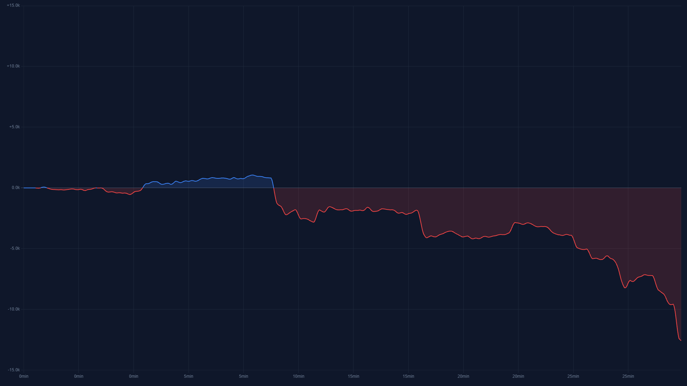

# lol-graph

Real-time team gold tracker for League of Legends.

lol-graph captures the in-game scoreboard once per second, reads both teams' gold
totals with a local OCR model (PaddleOCR), stores the readings in MariaDB, and
serves a web dashboard with a live gold-difference graph, PNG export, and
streaming-overlay widgets.



*Sample graph of one game.* The vertical axis is the gold difference in thousands
(**blue team gold − red team gold**) and the horizontal axis is game time. Above
the zero line (blue) the blue team is ahead; below it (red) the red team is
ahead. The curve is smoothed with a Gaussian moving average (add `?smooth=1`
to the graph URL, or use the PNG export).

## Requirements

- **Windows** for live capture. Screen capture (`node-screenshots`) needs the Win32 desktop.
- **Node.js 26** or newer.
- **Docker Desktop** for the bundled MariaDB (or any reachable MariaDB instance).

## Quick start (Windows, PowerShell)

```powershell
npm install
Copy-Item .env.example .env
npm run db:up        # starts MariaDB in Docker
npm run dev          # http://localhost:3000
```

Tables are created automatically on startup. Leave `DB_HOST` unset in `.env`: it
defaults to `127.0.0.1`, which is correct when the app runs on your machine.

## Run everything in Docker (with the bundled MariaDB)

This runs the dashboard **and** a local MariaDB in containers, with no external
database. The container can show dashboards and graphs but cannot capture the
game (screen capture needs Windows), so use it to view or serve existing games.

### With GitHub Desktop

1. Install [Docker Desktop](https://www.docker.com/products/docker-desktop/) and
   [GitHub Desktop](https://desktop.github.com/), then start Docker Desktop.
2. In GitHub Desktop: **File → Clone repository**, pick this repo, and click **Clone**.
3. Open a terminal in the repo: **Repository → Open in PowerShell**.
4. Create your settings file (defaults work as-is):
   ```powershell
   Copy-Item .env.example .env
   ```
5. Build and start the app and the database:
   ```powershell
   docker compose --profile db up -d --build
   ```
6. Open <http://localhost:3000>.

To stop: `docker compose --profile db down` (your data is kept). To remove the
data too, add `-v`. To update, click **Fetch origin / Pull** in GitHub Desktop and
re-run step 5.

### Notes

- Do **not** set `DB_HOST=127.0.0.1` in `.env` for this setup. Inside a container
  that address is the container itself. Leave `DB_HOST` unset (it defaults to `mariadb`).
- `./data` is mounted into the container so `config.json` survives restarts.
- To use your own MariaDB instead, omit `--profile db` and set `DB_HOST`,
  `DB_USER`, `DB_PASSWORD` and `DB_NAME` in `.env`.

## Scripts

| Script | Description |
| --- | --- |
| `npm run dev` | Run from source with auto-reload |
| `npm run build` | Compile TypeScript to `dist/` |
| `npm start` | Run the compiled app |
| `npm test` | Run the Jest test suite |
| `npm run typecheck` | Type-check sources and tests |
| `npm run db:up` / `db:down` | Start / stop the local MariaDB container |
| `npm run docker:build` | Build the Docker image |
| `npm run docker:up` / `docker:down` / `docker:logs` | Manage the Compose stack |

## Configuration

**Environment** (`.env`, copied from `.env.example`):

| Variable | Default | Description |
| --- | --- | --- |
| `PORT` | `3000` | Dashboard port |
| `CONFIG_DIR` | working directory | Directory containing `config.json` |
| `DB_HOST` | `127.0.0.1` (`mariadb` under Docker Compose) | MariaDB host |
| `DB_PORT` | `3306` | MariaDB port |
| `DB_USER` / `DB_PASSWORD` | `root` / *(empty)* in the app; `lolgold` / `lolgold` in `.env.example` and the bundled MariaDB | MariaDB credentials |
| `DB_NAME` | `btg_temp` | Database name |
| `DB_ROOT_PASSWORD` | `rootpassword` | Root password of the bundled MariaDB container only |

**Runtime settings** (`config.json`, created on first run and editable from the
dashboard): target window name, capture regions for each team's gold counter,
the selected game, and the auto-start / auto-stop toggles.

## Usage

1. Open the dashboard at `/` and create a game (or select an existing one).
2. Pick the League of Legends window and adjust the two capture regions if needed.
3. Click **Start OCR**, or enable **Auto Start** to begin recording as soon as
   gold values are detected. **Auto Stop** ends the session and deselects the game
   after 5 consecutive failed reads (e.g. when the game ends).

Readings that jump by 10k or more from the previous one are treated as OCR
misreads and discarded.

| Page | Description |
| --- | --- |
| `/` | Dashboard: games, session controls, capture settings |
| `/recent` | Recent games list |
| `/graph/:uuid` | Live gold-difference graph (`?smooth=1` for Gaussian smoothing) |
| `/widget/:uuid` | Chrome-less graph for stream overlays |
| `/widget/current` | Overlay that follows whichever game is active |

### API

| Method | Path | Description |
| --- | --- | --- |
| `GET` | `/api/games?page=&perPage=` | Paginated game list |
| `POST` | `/api/games` | Create a game `{ name?, description? }` |
| `GET` | `/api/games/:uuid` | Game metadata |
| `GET` | `/api/session/status` | Current session state |
| `POST` | `/api/session/start` | Start recording `{ gameUUID }` |
| `POST` | `/api/session/stop` | Stop recording |
| `POST` | `/api/session/select` | Select a game without starting `{ gameUUID \| null }` |
| `GET` | `/api/session/events` | Server-sent events for session changes |
| `GET` / `POST` | `/api/config` | Read / patch runtime settings |
| `GET` | `/api/config/processes` | Visible windows available for capture |
| `GET` | `/api/graph/:uuid/data` | Graph readings as JSON |
| `GET` | `/api/graph/:uuid/export?smooth=1` | Graph as a PNG |

Errors are returned as `{ error, code, statusCode }`.

## Troubleshooting

| Problem | Fix |
| --- | --- |
| Docker app cannot connect to the database | Remove `DB_HOST` from `.env` (or set it to `mariadb`) and make sure you started with `--profile db`. |
| `ECONNREFUSED 127.0.0.1:3306` when running `npm run dev` | Start the database with `npm run db:up` and check that Docker Desktop is running. |
| The League window is missing from the window list | Run the app on Windows (not in Docker) with the game open, then refresh the list. |
| No gold values are read | Adjust the two capture regions on the dashboard so they sit exactly on the gold counters. |
| Engine / version error on `npm install` | Install Node.js 26 or newer (`node -v`). |
| Port 3000 already in use | Set a different `PORT` in `.env`. |

## Project layout

```
src/
  index.ts            entrypoint: config, DB, OCR worker, HTTP server
  config/             config.json schema + env-based DB config
  db/                 MariaDB pool, migrations, queries
  ocr/                worker thread: capture → preprocess → OCR → parse
  session/            session state machine, worker supervision, DB inserts
  graph/              reading transformation, smoothing, PNG export
  server/             Fastify server, routes, error helpers
public/               dashboard, graph and widget pages (static)
tests/                Jest unit tests
docs/                 README images
data/                 config.json when running in Docker (git-ignored)
Dockerfile, docker-compose.yml
```

## License

[MIT](LICENSE) © 2026 imthespyke
